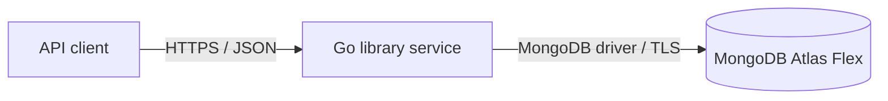

# Library manager architecture

## Goal and scope

Build a Go HTTP API backed by MongoDB Atlas Flex on Azure for the initial experiment. Clients manage libraries, books, and members, and record books being borrowed and returned. There is no user interface.

This document describes a proposed first version, not an implementation. Authentication, deployment details, and several product rules need decisions before production use.

## System context

The service is stateless: multiple instances can serve requests against the same database. MongoDB is the source of truth. Configuration supplies the connection URI, database name, server address, and operational settings; secrets come from the deployment environment or a secret store, not the repository.

## Initial database deployment decision

Selected on 2026-11-13: MongoDB Atlas Flex on Azure, targeting its lowest usage-based price for this low-load experiment. This records the deployment choice; a cluster has not yet been provisioned.

- Flex is a shared tier, not a selectable CPU/RAM instance size. The base price is approximately US$8 per 30 days (US$0.011/hour), covering up to 100 database operations per second.
- Storage is limited to 5 GB, including documents and indexes.
- Higher operation rates increase the Flex cluster charge automatically, up to the advertised US$30 per month. The base price is not a configured spending cap; load tests can raise usage charges.
- Select an Azure region supported by Flex when provisioning, preferably the same region as the API. The API hosting service and region remain open.
- Keep connection settings and credentials external to the code, and preserve the persistence boundary so a future provider change can be validated without changing the HTTP API.

Pricing reference: [Atlas Flex costs and usage](https://www.mongodb.com/docs/atlas/billing/atlas-flex-costs/), checked on 2026-11-13. Verify current pricing when provisioning. Revisit the tier if the experiment outgrows its capacity or requires additional operational features.

## Service design

Organize the service by responsibility, without prescribing a package layout yet:

- **HTTP layer:** routes, JSON validation, status codes, pagination, and request cancellation.
- **Application layer:** CRUD operations and borrowing rules; coordinates atomic changes.
- **Domain model:** libraries, books, members, and loans, including their invariants.
- **Persistence layer:** MongoDB collections, indexes, and transaction handling behind interfaces needed by the application layer.

Use the official MongoDB Go driver. Pass `context.Context` from requests to database operations and set bounded timeouts. Expose health endpoints for process liveness and database readiness. Log structured operational events without credentials or unnecessary member data.

## Domain and data

The initial model makes the following assumptions so the API can be designed consistently:

- A library has an ID, name, and optional descriptive information.
- A book represents one lendable physical copy, has an ID, library ID, title, and optional author and ISBN. Multiple copies may share an ISBN.
- A member has an ID, name, and contact information. Members are service-wide; a loan links a member to a book in a library.
- A loan has an ID, book ID, library ID, member ID, borrowed timestamp, optional due timestamp, and return timestamp. An absent return timestamp means the loan is active. Retain returned loans as history.
- A book can have at most one active loan. A member can hold multiple books; limits and due-date policy are not yet specified.

Store these as separate `libraries`, `books`, `members`, and `loans` collections. Use stable opaque IDs in the API. Validate referenced records when creating books and loans. Index books by library, and loans by member, library, and book as needed for listing. Enforce at most one active loan per book with a unique partial index, using a consistent explicit active status or equivalent indexable representation. Create the loan and update any book availability state atomically; preferably derive availability from active loans to avoid duplicated state. Handle duplicate-key conflicts as a borrowing conflict. Operations that require multiple writes must use transactions on a deployment that supports them.

Deletion must not orphan records or erase loan history: reject deletion of a library with books, and reject deletion of a book or member with loan history. Clients can resolve dependencies before deletion where possible. This conservative policy, including whether archival or soft deletion is needed, is open to product review. Updates cannot move a book to another library while it has loan history, preserving historical library attribution.

## Proposed HTTP API

Use JSON request and response bodies and a versioned `/api/v1` prefix. IDs are opaque strings. Collection endpoints support bounded pagination; filtering and ordering can be specified as client needs emerge.

| Resource | Endpoints |
| --- | --- |
| Libraries | `POST /libraries`, `GET /libraries`, `GET /libraries/{libraryId}`, `PATCH /libraries/{libraryId}`, `DELETE /libraries/{libraryId}` |
| Books | `POST /libraries/{libraryId}/books`, `GET /libraries/{libraryId}/books`, `GET /libraries/{libraryId}/books/{bookId}`, `PATCH /libraries/{libraryId}/books/{bookId}`, `DELETE /libraries/{libraryId}/books/{bookId}` |
| Members | `POST /members`, `GET /members`, `GET /members/{memberId}`, `PATCH /members/{memberId}`, `DELETE /members/{memberId}` |
| Loans | `POST /libraries/{libraryId}/books/{bookId}/loans` to borrow; `POST /loans/{loanId}/return` to return; `GET /loans` and `GET /loans/{loanId}` to inspect history |

A borrow request identifies an existing member and may include a due date. It succeeds only when the library, book, and member exist, the book belongs to that library, and the book has no active loan. Returning an active loan records its return time; returning an already returned loan is a conflict. Loan listing should support filtering by member, library, and active status.

Use `201 Created` for creation, `200 OK` for reads and updates, and `204 No Content` for successful deletion. Return consistent JSON errors: `400` for invalid input, `404` for missing resources or mismatched library/book paths, `409` for invariant or deletion conflicts, and `500` for unexpected failures. Do not expose database internals in errors. Exact schemas and pagination tokens should be defined in an OpenAPI contract before implementation.

## Operations and quality

- Require TLS for cloud database connections and HTTPS at the service boundary; use least-privilege database credentials and a secret store in deployment.
- Validate the MongoDB driver features, indexes, and transactions used by the implementation against Atlas Flex. Repeat compatibility and concurrency testing before any future provider change; MongoDB-compatible products can differ in behavior.
- Provide database connection and request timeouts, graceful shutdown, readiness checks, structured logs, and basic request/error/latency metrics.
- Unit-test domain and application rules. Integration-test persistence against a MongoDB deployment with the required transaction and index support, including concurrent attempts to borrow the same book and deletion races.
- Enforce referential and deletion invariants under concurrency, using transactions or another database-enforced strategy rather than relying on unprotected read-then-write checks.

## Open decisions

- Azure region, API hosting environment, database provisioning and billing setup, and deployment automation.
- Authentication, authorization, and tenant boundaries for API clients.
- Required fields, validation rules, privacy and retention requirements for members.
- Loan duration, renewals, borrowing limits, overdue handling, and lost or damaged books.
- Deletion versus archival, and how to handle historical records when a member or library leaves.
- API schemas, pagination format, and compatibility/versioning policy.
